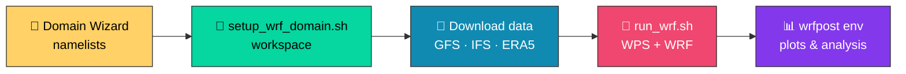

<div align="center">

# 🌦️ Automation-Utility-Scripts

### ⚡ WRF Utility Preprocessor & Automation Scripts ⚡

*From domain design to forecast to plots — with a handful of shell scripts.*


### 🧭 [**Open the WRF / WPS Domain Wizard →**](https://goikelem.github.io/Automation-Utility-Scripts/WRF_WPS_Domain_Wizard.html)

</div>

---

## 📖 About

This repository provides a collection of **bash (and Python) utility scripts** that automate the
**Weather Research and Forecasting (WRF)** model workflow. Assuming you already have a working
WRF/WPS installation, these scripts take care of:

- 🗂️ **Domain-specific workspace setup**
- 📡 **Meteorological data retrieval** (GFS, ECMWF IFS, ERA5)
- 🚀 **Model execution** (WPS → `real.exe` → `wrf.exe`)
- 📊 **Python post-processing environment** configuration

🌐 Project site: <https://goikelem.github.io/Automation-Utility-Scripts>

---

## 🚀 Key Features

| | Feature | What you get |
|:-:|:--|:--|
| 🧱 | **Isolated workspaces** | Domain-specific directories with pre-linked executables, namelists and Vtables |
| 📉 | **Efficient data retrieval** | Server-side subsetting of GFS 0.25° data to save bandwidth and storage |
| 🔁 | **End-to-end automation** | Auto-updates namelist dates, runs `geogrid`, `ungrib`, `metgrid`, `real.exe` and `wrf.exe` |
| 🧪 | **Post-processing ready** | A dedicated Conda env with `wrf-python`, `cartopy`, `xarray` and more |
| 🗺️ | **Interactive Domain Wizard** | A browser-based tool to design domains and generate namelists |

---

## 🗺️ Workflow at a glance



---

## 📂 Contents

| 📄 File | 🎯 Purpose |
|:--|:--|
| 🧭 [**WRF_WPS_Domain_Wizard.html**](https://goikelem.github.io/Automation-Utility-Scripts/WRF_WPS_Domain_Wizard.html) | Interactive web tool for designing domains and generating `namelist.wps`, `namelist.input` (and optional Chem / Fire / Hydro namelists) |
| 🧱 [`setup_wrf_domain.sh`](./setup_wrf_domain.sh) | Creates an isolated working directory for a domain, links WPS/WRF executables, copies namelists and Vtables, fetches the other utility scripts, updates `~/.bashrc` |
| 📡 [`download_025_gfs.sh`](./download_025_gfs.sh) | Downloads and subsets **GFS 0.25°** GRIB2 data from NOAA NOMADS, keeping only the variables and levels WRF needs |
| 🇪🇺 [`download_ecmwf_ifs_025.sh`](./download_ecmwf_ifs_025.sh) | Downloads **ECMWF IFS 0.25°** forecast data for use as WRF initial and boundary conditions |
| 🌍 [`download_era5.sh`](./download_era5.sh) | Shell wrapper for downloading **ERA5** reanalysis data |
| 🐍 [`download_era5.py`](./download_era5.py) | Python (CDS API) downloader for **ERA5** reanalysis data |
| 🚀 [`run_wrf.sh`](./run_wrf.sh) | Automates the whole pipeline: updates namelist dates, runs WPS, `real.exe`, then `wrf.exe` |
| 📊 [`create_wrfpost_env.sh`](./create_wrfpost_env.sh) | Builds the `wrfpost` Conda environment for visualising and analysing WRF output |

---

## 📋 Prerequisites

- ✅ A working **WRF/WPS installation** (expected by default at `$HOME/Build_WRF`)
- 🛠️ **System tools:** `bash`, `curl` or `wget`, `csh`/`tcsh`
- 🐍 **Python:** `conda` (Anaconda or Miniconda) for the post-processing environment
- 🔑 *For ERA5 only:* a free [Copernicus CDS](https://cds.climate.copernicus.eu/) account and API key

---

## ⚡ Workflow & Usage

### 0️⃣ Design your domain 🧭

Open the **[WRF / WPS Domain Wizard](https://goikelem.github.io/Automation-Utility-Scripts/WRF_WPS_Domain_Wizard.html)**
in your browser. It supports multiple map projections (Lambert, Mercator, Polar Stereographic,
Lat-Lon), nested domains, an interactive map with drag-and-resize domains, and optional
**WRF-Chem**, **WRF-Fire** and **WRF-Hydro / HRLDAS** namelists. Nothing is written to disk until
you download the generated files.

### 1️⃣ Initialize the domain workspace 🧱

```bash
chmod +x setup_wrf_domain.sh
./setup_wrf_domain.sh
# Enter a domain name when prompted (e.g. ethiowrf)
```

> 💡 Place the `namelist.wps` and `namelist.input` generated by the Domain Wizard inside the newly
> created domain directory.

### 2️⃣ Download meteorological data 📡

**GFS 0.25°** (NOAA NOMADS):

```bash
cd $WRF_HOME/ethiowrf
./download_025_gfs.sh 20261016 00 72     # YYYYMMDD  CYCLE  FORECAST_HOURS
```

**ECMWF IFS 0.25°:**

```bash
./download_ecmwf_ifs_025.sh              # see the script header for arguments
```

**ERA5 reanalysis** (needs a CDS API key in `~/.cdsapirc`):

```bash
./download_era5.sh                       # shell wrapper
python download_era5.py                  # or call the Python downloader directly
```

### 3️⃣ Run the model 🚀

```bash
# 🤖 Automatic mode: today's date, 00 UTC, 72-hour forecast
./run_wrf.sh --auto

# ✍️ Manual mode: specify date, cycle and forecast length
./run_wrf.sh 20261016 00 72

# 🔄 Force geogrid to run (if the domain configuration changed)
RUN_GEOGRID=1 ./run_wrf.sh 20261016 00 72
```

The script updates the namelist time variables, runs **WPS** (`geogrid`, `ungrib`, `metgrid`),
runs **`real.exe`** and **`wrf.exe`**, and renames output files for cross-platform compatibility.

### 4️⃣ Set up post-processing 📊

```bash
cd $WRF_HOME/scripts
chmod +x create_wrfpost_env.sh
./create_wrfpost_env.sh
conda activate wrfpost
```

The `wrfpost` environment includes `wrf-python`, `cartopy`, `xarray` and related libraries.

---

## 📚 References

- 🌀 **WRF Model:** <https://github.com/wrf-model/WRF>
- 🎓 **WRF Online Tutorial:** <https://www2.mmm.ucar.edu/wrf/OnLineTutorial/>
- 🇺🇸 **NOAA NOMADS:** <https://nomads.ncep.noaa.gov/>
- 🇪🇺 **Copernicus Climate Data Store (ERA5):** <https://cds.climate.copernicus.eu/>

---

## 👤 Author

**Goitom K.** · ✉️ [goikelem@gmail.com](mailto:goikelem@gmail.com)

<div align="center">

⭐ *If these scripts save you time, consider giving the repo a star!* ⭐

</div>
